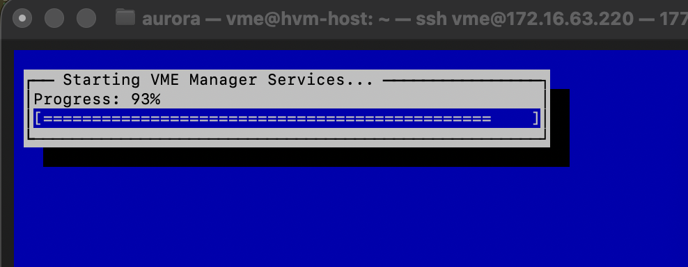
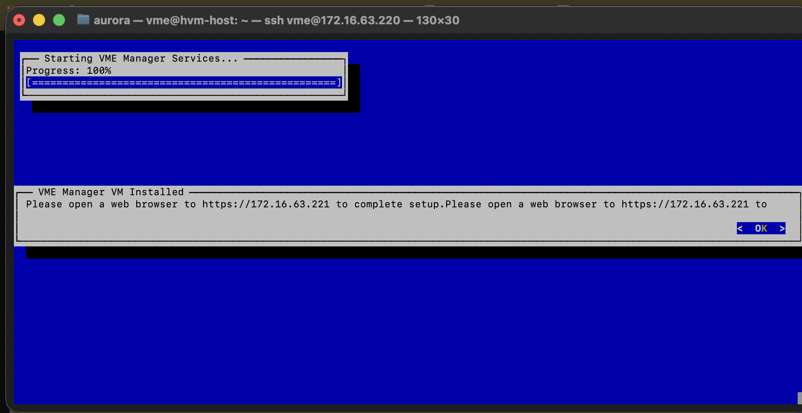
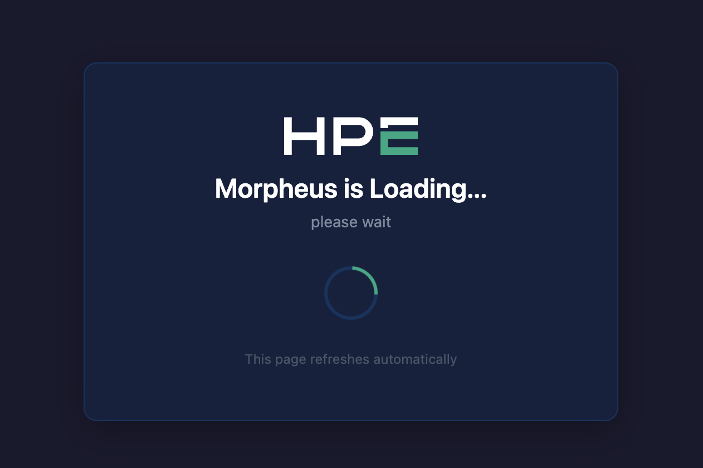
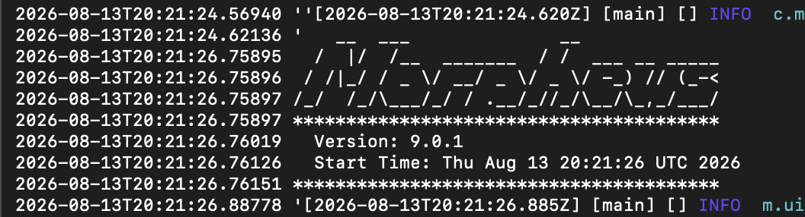

# vme-hogent
Full HPE VM Essentials stack: HVM hosts + VME Manager + Ceph. Optional extra suffering: running the whole thing nested on Nutanix, because one hypervisor is never enough.
(Yes, I still shove overlay networking into everything. No, VME doesn't come with NSX. Yes, I checked. Twice.)

## Notice
- I will use the terms HVM, VME Manager, Ceph and OVS during this guide. HVM is the host: Ubuntu with KVM, libvirt and friends. The VME Manager is the brain, a VM that lives on your first host. Ceph is the storage. OVS is Open vSwitch, and it will ruin at least one of your evenings.
- The VME Manager is Morpheus wearing a trench coat. The loading screen doesn't even pretend. You'll see.
- Everybody lies. Especially progress bars. Keep that in mind.

## Deployment War Stories
- 13 August 2026, an evening. Log paths started flying around the group chat at half past nine. Morpheus finally logged its start time at 20:21 UTC. That's 22:21 in Belgium. You do the math, I'm still recovering.
- A good chunk of that was spent staring at a progress bar sitting at 93%. Not 92. Not 94. Ninety-three. Like it was trying to make a point.
- Moral of the story: the installer isn't stuck, it's thinking. Usually. Sometimes it's stuck. Telling those two apart is the entire skill this guide is trying to teach you.



## What do you need?
- Courage
- No fear (still different, still trust me)
- Three Ubuntu Server 24.04 VMs on cigrit. Or real servers, if you're one of those people who own real servers. With VT-x or AMD-V, and preferably ones that boot.
- 4 vCPU per host. 16 GB RAM per host, but give host 1 at least 32 GB. The VME Manager lives there and it eats like a teenager.
- Two disks per host: ~60 GB for the OS and a separate ~150 GB disk for Ceph. HPE says 500 GB "for testing". Someone ran it on 100 GB and lived to blog about it. We meet in the middle.
- An HPE account and a VM Essentials evaluation licence (more on this later, patience is still a virtue)
- Static IPs. Working DNS. Actual internet access on the hosts. Yes, all three. Yes, really.
- Common sense (still optional, still highly recommended, still surprisingly rare)

## HPE Account
- Notice: One per team is enough. Share nicely. Or don't. I'm still not here to teach you manners.
- Head over to the [HPE VM Essentials page](https://www.hpe.com/us/en/hpe-vm-essentials.html) and request the trial. That gets you into the HPE Software Center with a 60-day evaluation licence.
- If the signup form fights you: you're not special. There is a thread on the HPE community literally called "can't sign up for the free trial". Take comfort in that. Then try again.
- Download the VM Essentials software ISO. It has two things inside that you care about: the `hpe-vm_<version>_amd64.deb` package for the hosts, and a `hpe-vm-essentials-<version>.qcow2.gz` disk image for the Manager. Keep both. Yes, you need both. No, don't unzip the .gz. The installer eats it whole.
- The curl download link they hand you expires after 24 hours. Like a Mission: Impossible briefing, minus Tom Cruise.
- Write your credentials down. Tattoo optional this time; your forearm is probably still full from the Nutanix guide.

# The Nested Tax
(Skip this if you're on bare metal. You lucky thing.)

You're putting a hypervisor inside a hypervisor so your VM can have VMs. Yo dawg. Nutanix has to allow that, and you don't have the rights to tell it to.

- Create your three VMs first. Two disks each, SCSI. Then send a mail to Annick Burms with the names of your three VMs and ask her, nicely, to run this:
- `acli vm.update <VM_NAME> cpu_passthrough=true`
- Be nice. She holds the keys. Literally.
- It only kicks in after a full power cycle from Prism. A reboot from inside Ubuntu doesn't count: the QEMU process underneath your VM has to restart. Google why. It's a good rabbit hole.
- Check that it worked, from inside each VM: `grep -cE 'vmx|svm' /proc/cpuinfo`
- Anything above 0: congratulations, you're a hypervisor now. A 0: send another mail. Nicer this time.
- Want VLAN trunks into your hosts? That needs a trunked vNIC on AHV (`vlan_mode=kTrunked`, look it up), and that also needs acli. Put it in the same mail. Batch your begging.

# Installing the Hosts
Two ways: the Lazy Way and the Classic Way. Like Prism Central, except this time the lazy way tends to work. Tends to.

## The Lazy Way: the integrated ISO
- Since 8.0.8, HPE ships an all-in-one installer ISO: Ubuntu 24.04 with hpe-vm baked in. Boot it, give the server a name and credentials, walk away. It reboots when it's done.
- Log in, run `sudo hpe-vm`, and skip ahead to [The hpe-vm Console](#the-hpe-vm-console).
- Still read the Classic Way. The networking and cloning gotchas apply to you too. Nobody escapes the gotchas.

## The Classic Way: Ubuntu first, VME second
- Install Ubuntu Server 24.04 LTS. Nothing fancy. Tick "Install OpenSSH server", because you are not typing 40-character commands into the Prism console like an animal.
- Give it a static IP during the install. DHCP is for clients. You are not a client. You are infrastructure now.
- Install Ubuntu on the OS disk only. Leave the Ceph disk alone. Unpartitioned. Untouched. Pristine. Ceph wants it raw.
- Once you're in, update everything: `sudo apt update && sudo apt full-upgrade -y`
- Stop cloud-init from "helping" with your network on every boot:
- `echo 'network: {config: disabled}' | sudo tee /etc/cloud/cloud.cfg.d/99-disable-network-config.cfg`
- Check that ufw isn't standing in the doorway: `sudo ufw status` should say inactive. If it doesn't: `sudo ufw disable`. Hosts that can't talk to the Manager don't join clusters.
- Get the ISO onto the VM. Either scp it over, or attach it as a CD-ROM in Prism. Then:

```bash
sudo mkdir -p /mnt/iso
sudo mount -o loop HPE_VM_Essentials_*.iso /mnt/iso   # or: sudo mount /dev/sr0 /mnt/iso
sudo apt install -f /mnt/iso/hpe-vm_*_amd64.deb -y
```

- That installs the hypervisor plumbing and the hpe-vm console itself. Takes about five minutes. Go refill the coffee. You know the drill by now.

## Cloning (or: how to have three identical problems)
Build one host properly, then clone it twice. Smart. Just know that clones are a little too identical.

- Clone BEFORE you touch the hpe-vm console. Cloning a host that already has a Manager on it gives you two Managers and zero friends.
- Change the hostname: `sudo hostnamectl set-hostname hvm-02`
- Change the IP in `/etc/netplan/*.yaml`, then `sudo netplan apply`.
- Regenerate the machine-id. SKIP THIS AND YOUR THREE HOSTS WILL BELIEVE THEY ARE THE SAME HOST. THE CLUSTER WILL BELIEVE THEM TOO. NOBODY WINS.
- `sudo rm -f /etc/machine-id && sudo systemd-machine-id-setup`
- Regenerate the SSH host keys too, unless you enjoy being screamed at with "REMOTE HOST IDENTIFICATION HAS CHANGED":
- `sudo rm /etc/ssh/ssh_host_* && sudo dpkg-reconfigure openssh-server`
- Reboot. Check. Reboot again if it makes you feel better. I won't tell anyone.

# The hpe-vm Console
- `sudo hpe-vm`
- It's blue. Not *that* blue screen. Relax. This one is on your side. Mostly.
- You'll get a menu along the lines of: Keyboard Layout / TimeZone, Configure Network, Install VME Manager, Exit. Older versions called that third one "Install Morpheus". See? Trench coat. Names shift a bit between versions, so read the screen. Reading is still fundamental.
- Set your timezone. Ceph cares about time more than your teacher cares about deadlines. Clock skew makes Ceph sad, and a sad Ceph is a loud Ceph. `timedatectl` should say "System clock synchronized: yes".
- Configure Network is where the real fun lives. Bonds, MTUs, the works. In production you'd go 10 Gbps, jumbo frames and LACP. Here: keep it boring. Boring works.
- DO NOT DEFINE YOUR VM VLANS IN NETPLAN. Netplan and Open vSwitch both want to own your VLANs, like divorced parents fighting over the kids. Let OVS have them. Only the management network belongs in netplan. Someone found this out the hard way so you don't have to (link at the bottom).

# Deploying the VME Manager
Host 1 only. One Manager. Not three. There can be only one. (Highlander. Look it up, you child.)

- In the console, pick Install VME Manager and fill in the form. Here's what it asks, and where people faceplant:
- **IP, netmask, gateway, DNS**: the netmask is dotted (255.255.255.0), not CIDR. Mix them up and you get something like `... is not contained in '255.255.255.0/24'`, which is the installer's way of saying "pick one".
- **Appliance URL**: the address your hosts will use to reach the Manager. Put an FQDN in there and it had better resolve, from the hosts, right now. If it doesn't, you've ordered the 99% special. When in doubt, use the IP. It's always DNS. Even when it isn't, it's DNS.
- **Hostname, admin user, password**: write them down. All of them. Future you will need at least one of them at 23:00.
- **Image URI**: where the Manager disk image lives, for example `file:///mnt/iso/hpe-vm-essentials-<version>.qcow2.gz`. Three slashes. Yes, three. The .gz is fine as it is.
- **Size**: Small. You don't have 500 hosts queued. Stop flexing.
- **Management interface**: the NIC (or bond) that carries your host IP. Pick the wrong one and the Manager boots into the void.
- If anything asks about the CPU type of the Manager VM: don't shrug. A wrong CPU setting is a known way to hang at 99%, and nested on Nutanix you're already pushing your luck.
- My host is 172.16.63.220, my Manager 172.16.63.221. Yours aren't. Use yours. Pattern recognition still isn't rocket science.
- Hit go. You get "Starting VME Manager Services..." and a progress bar. It will crawl. It will park itself at 93% and stare at you. That's normal. Probably.
- MOST IMPORTANTLY: the Manager's networking takes a good two minutes, often more, to come online. Do not panic at minute one. Panic at minute ten, like a professional.
- And then, eventually:



- It tells you twice where to go. It knows you weren't listening the first time.

## Morpheus is Loading...
- Open that URL. You get this:



- "This page refreshes automatically." It does. Eventually. Go admire some grass.
- Told you. Morpheus. In a trench coat.
- Want to know if it's actually doing something, or just pretending? SSH into the Manager VM (mine's called vmemgr, yours isn't) and tail the app log:
- `sudo morpheus-ctl tail morpheus-ui`
- When the ASCII art shows up, it's alive. Mine said Version 9.0.1. Give it a few more minutes after that before you start clicking around.



# When It's Stuck at 99% (or 93%, or wherever your hope died)
Everybody lies. Progress bars most of all. Here's how you find out what's actually going on.

- Watch the installer log on host 1. This is the one that matters: `sudo tail -F /var/log/hpe-vm/hpe-vm.log`
- Just walked back in and need to catch up? `sudo tail -200 /var/log/hpe-vm/hpe-vm.log`
- Depending on your version there might also be things in `/var/log/hpe-vme/`. Check both. It costs nothing.
- Is the Manager VM even running? `sudo virsh list --all`
- Is it plugged into anything? `sudo virsh domiflist <manager-vm>`
- Does the management bridge exist? People have hit installs where the OVS mgmt bridge simply never got created: `sudo ovs-vsctl show`
- What does netplan think is going on? `sudo netplan status --all`
- The usual suspects, in order of likelihood: DNS (it's always DNS), a wrong IP or netmask, the wrong management interface, cloud-init rewriting your network behind your back, ufw.
- Completely wrecked it and want a clean slate? There's a cleanup script for failed deployments: `sudo /opt/hpe-vm/scripts/reset_host.sh`
- READ IT BEFORE YOU RUN IT. It's called reset for a reason. Run it on the wrong host and don't come crying to me. I told you. Right here. In caps.
- After a host reboot, the Manager VM might not come back by itself. Check: `sudo virsh dominfo <manager-vm> | grep -i autostart`. If it says disable: `sudo virsh autostart <manager-vm>`. You're welcome.

# First Login
- Once the loading screen gives up and lets you in, you get a setup wizard: master tenant, master user, appliance name, appliance URL, licence.
- The master user is the god account. Treat its password accordingly. Not "Welkom123". I've seen your passwords. I've seen things.
- The appliance URL has to be reachable from your hosts on port 443. That's how the agents on your hosts phone home. If they can't, your cluster build hangs and you'll blame HPE. It's your network. It's always your network.
- Licence: paste in the evaluation one. 60 days. Set a reminder. Or don't, and find out the fun way.

<!-- screenshot: setup wizard -->

# Building the Cluster
This is where three lonely Ubuntu boxes become one cluster. In theory.

- Head over to Infrastructure > Clusters and add a new cluster. Pick the HVM type.
- Pick a layout that includes Ceph. Otherwise you just built three hosts with no shared storage and a whole lot of nothing.
- Add your three hosts. The Manager SSHes into every one of them, so those SSH credentials had better work. Test them yourself first. Thirty seconds of `ssh` saves thirty minutes of staring.
- You'll give each network interface a job: management, storage (Ceph) and compute (VM traffic). Get this wrong and it'll still deploy. It just won't work. Which is worse.
- Pick the Ceph data disk on every host. That's the raw one you didn't touch. You didn't touch it. Right?
- Ports, in case your network has opinions: 22 (SSH), 443 (agent), 3300 and 6789 (Ceph monitors), 6800-7300 (Ceph OSDs).
- Hit go and watch it provision. Grab a coffee. Grab two. One for you, one for Ceph.

<!-- screenshot: cluster provisioning -->

## Is Ceph Happy?
- On any host: `sudo ceph -s`
- HEALTH_OK: congratulations. HEALTH_WARN: it's complaining, so read what it says. HEALTH_ERR: well. You had a good run.
- Clock skew warnings? That's the timezone thing. I told you. I literally told you.
- Now compare your usable capacity to the raw capacity of your three disks, and go Google what a replica count is. Do the math. Put it in your documentation, because someone is going to ask. (Hint: that someone is your teacher.)

# Making It Do Things
- Spin up a VM on the Ceph datastore. Ubuntu, Windows 10, whatever floats your boat. Make sure it can actually surf. If it can't, it's the VLANs. It's always the VLANs. Unless it's DNS.
- Live migration: move that VM to another host while it's running. Keep a ping going so you can prove it never dropped. Screenshots or it didn't happen.
- HA: now go to Prism and hard power off one of your hosts. Pulling-the-plug style. Watch what VME does.
- Someone else measured close to four minutes before VME declared their host dead, and about ten before it was back in the cluster. Time yours. Compare. Brag or cry.
- Turn the host back on and watch Ceph heal itself. It's oddly satisfying. Like watching someone else do the dishes.

# Log Cheat Sheet
Pin it. Print it. Frame it. You'll be back.

| Where | Command | What it's for |
|---|---|---|
| HVM host | `sudo tail -F /var/log/hpe-vm/hpe-vm.log` | The installer log that's actually in use. Start here. |
| HVM host | `sudo tail -200 /var/log/hpe-vm/hpe-vm.log` | Catching up after you walked away |
| HVM host | `sudo tail -F /var/log/hpe-vm/*` | When there's more than one file in there |
| HVM host | `sudo tail -F /var/log/hpe-vme/*` | Deployment logs on some versions. Check it, it's free. |
| HVM host | `sudo virsh list --all` | Is the Manager VM even alive? |
| HVM host | `sudo ovs-vsctl show` | Does the mgmt bridge exist? |
| HVM host | `sudo ceph -s` | Is Ceph happy? |
| HVM host | `sudo /opt/hpe-vm/scripts/reset_host.sh` | Not a log. The cleanup tool for a failed deployment. Read first, run second. |
| Manager VM | `sudo morpheus-ctl tail morpheus-ui` | Watch Morpheus wake up. ASCII art means it's alive. |

# And When You're Finished?
Are you done? Really done? Or did a progress bar hit 100% and you decided to stop asking questions?

Poke it. Kill a host again. Migrate a VM back and forth until it gets dizzy. Fill the Ceph pool and see what screams first. Break it on purpose while there's still time to fix it. That's the difference between "it works" and "I know why it works".

Step one: use Google like a professional. Step two: if that fails, grab `~scripts/hvm-preflight.sh` and run it on every host. It checks the things in this guide that people skip. It changes nothing. It only judges. Consider it a parting gift, not a habit you should develop.

```bash
curl -fsSLO https://raw.githubusercontent.com/AuroraRyunix/vme-hogent/main/~scripts/hvm-preflight.sh
sudo bash hvm-preflight.sh 172.16.63.221   # your Manager's IP or FQDN, not mine
```

# The People Who Suffered Before You
- [HPE Morpheus VM Essentials documentation (v9.0.2)](https://support.hpe.com/hpesc/public/docDisplay?docId=sd00008401en_us&page=index.html&docLocale=en_US)
- [A nested three-node VME lab](https://my-sddc.net/new-tech-vm-essentials-a-more-serious-deployment/): the netplan vs OVS VLAN fight, the CPU setting that hangs at 99%, and those HA timings
- [The integrated installer ISO](https://my-sddc.net/new-tech-hpe-vme-essentials-integrated-installation/)
- [HPE community: stuck at 99%](https://community.hpe.com/t5/hpe-morpheus-vm-essentials/hpe-vmessential-stuck-at-99/m-p/7258423)
- [Nested virtualization on Nutanix](https://www.reddit.com/r/nutanix/comments/143k7bz/enabling_nested_virtualization/)
- [Trunked vNICs on AHV](https://www.jordansphere.co.uk/change-nic-vm-in-ahv-to-trunk-mode/)

# A Thank You Note (and a Reality Check)
This is where I leave you. Again. You survived Nutanix. You'll survive this. Probably.

VME isn't magic. It's KVM, libvirt, Open vSwitch and Ceph, glued together with a nice web interface on top. Learn the parts and the whole thing stops being scary. Mostly.

Keep your backups close and your logs closer.

And that, my friends, is where our journeys part. Again.

-Aurora R.
